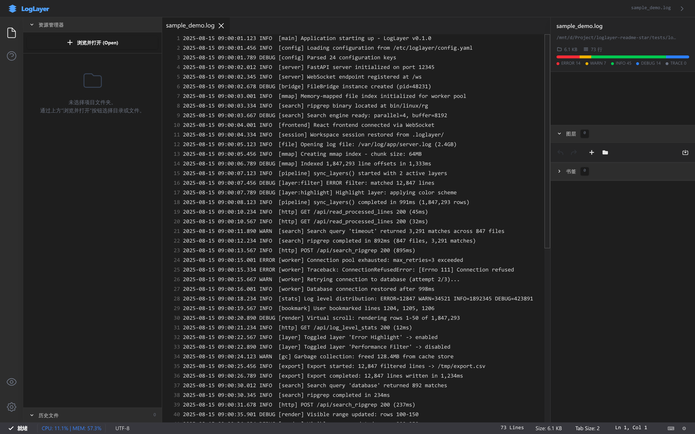
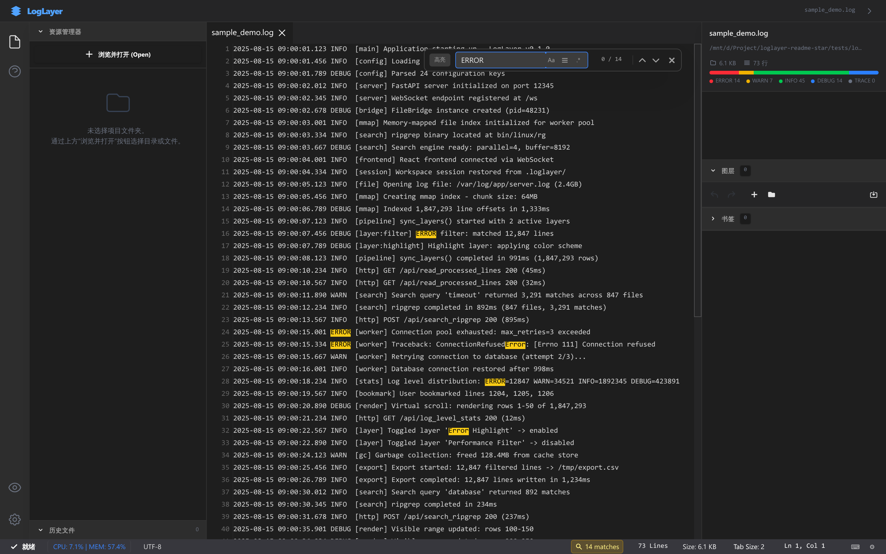
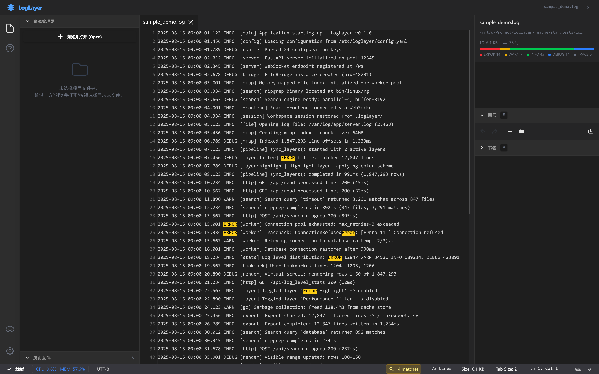
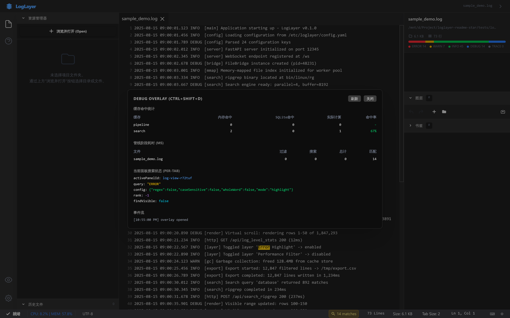

# LogLayer

<p align="center">
  <strong>Analyze GB-scale log files locally.</strong><br>
  Fast navigation, search, and layered analysis for developers and SREs.
</p>

<p align="center">
  <a href="https://github.com/qmjianda/loglayer/actions/workflows/ci.yml"></a>
  <a href="https://img.shields.io/badge/version-0.1.0-blue"></a>
  <a href="https://github.com/qmjianda/loglayer/blob/main/LICENSE"></a>
  <a href="https://github.com/qmjianda/loglayer/releases"></a>
</p>

<p align="center">
  <a href="#english">English</a> · <a href="#chinese">中文</a>
</p>



LogLayer is a local log viewer and analysis tool for developers, SREs, and operations teams. It indexes local files, renders only the visible rows, searches with the bundled `ripgrep` engine, and applies composable layers without modifying the original log.

> **v0.1.0 is the first public release.** LogLayer runs as a local FastAPI service with a browser UI. The old embedded desktop shell is no longer part of the application.

<a name="english"></a>
## English

### What is included

- **Large-file navigation**: line-offset indexing backed by `mmap`, with virtualized rendering in the browser.
- **Current-file search**: text, regular expression, case-sensitive, and whole-word search powered by `ripgrep`.
- **Two search modes**: highlight matches or filter out non-matching rows.
- **Layered analysis**: built-in filtering, level, range, time, relative-time, transform, highlight, row-background, and bookmark capabilities.
- **Bookmarks and annotations**: mark rows, add comments, jump between bookmarks, and export bookmark JSON from the command palette.
- **File watching**: poll the active file for changes and show a “new content” prompt. The current release detects changes but does not automatically re-index the file.
- **Workspace persistence**: restore files, open/closed state, layers, bookmarks, and editor layout for a workspace.
- **Plugin slots**: trusted plugins can register layers and widgets through the documented plugin contract.
- **Local API**: FastAPI REST endpoints, WebSocket signals, and automatic API docs at `/docs`.

### Screenshots

| Log viewer | Search and highlight |
| --- | --- |
|  |  |

| Layers panel | Diagnostics overlay |
| --- | --- |
|  |  |

### Quick start

#### Option 1: Docker

Docker runs the local service and serves the built browser UI. Mount the directory that contains the logs:

```bash
docker build -t loglayer .
docker run --rm -p 12345:12345 -v "$PWD:/workspace" loglayer
```

Open <http://127.0.0.1:12345>. In Docker, only files mounted into the container are available to LogLayer.

#### Option 2: Build from source

Requirements: Node.js 18+ and Python 3.10+.

```bash
git clone https://github.com/qmjianda/loglayer.git
cd loglayer
npm ci
python -m pip install -r requirements.txt
```

Start the service and Vite frontend in separate terminals:

```bash
# Terminal 1
python backend/main.py --no-ui

# Terminal 2
npm run dev
```

Open <http://127.0.0.1:3000>. `--no-ui` is retained for compatibility; the service mode is the only runtime mode.

You can pass one file or one folder to the backend command:

```bash
python backend/main.py path/to/app.log
python backend/main.py path/to/log-directory
```

Opening a file also makes its parent directory the workspace. Opening a folder selects the workspace; files are opened from the browser UI as needed.

#### Option 3: Production-style local service

Build the frontend and copy the output to `backend/www`:

```bash
npm run build
rm -rf backend/www
cp -r dist backend/www
python backend/main.py --no-ui
```

Then open <http://127.0.0.1:12345>. On Windows, copy `dist` to `backend\www` with Explorer or `xcopy` instead of the Unix `rm`/`cp` commands.

#### Option 4: Offline package

```bash
# Source package: target machine needs Python dependencies
python tools/package_offline.py

# Standalone package: requires PyInstaller during the build
python tools/package_offline.py --exe
```

The output is written to `dist_offline/`. The source package starts with `python app/main.py --no-ui`. The standalone executable is platform-specific: build it separately on Windows and Linux. The package includes the bundled `ripgrep` binaries for both supported platforms.

See [DEPLOY.md](DEPLOY.md) for packaging, standalone execution, and plugin deployment details.

### Basic workflow

1. Open the **Workspace** view and open a log file or folder.
2. Wait for indexing to complete. The status bar shows indexing, searching, and processing state.
3. Use **Search** or `Ctrl/Cmd + F` to find text in the active file. Toggle highlight/filter mode in the editor find bar.
4. Use the right inspector to add, configure, reorder, enable, disable, or remove layers.
5. Click the line-number gutter to add a bookmark. Add a comment from the bookmark popover.
6. Use **Help** for the in-app guide, the status bar keyboard button for the shortcut reference, and `Ctrl/Cmd + Shift + P` for the command palette.

### Built-in layers

| Group | Built-in capability | Behavior |
| --- | --- | --- |
| Processing | Filter | Text/regex filtering with optional invert mode |
| Processing | Level | Filter `INFO`, `WARN`, `ERROR`, `DEBUG`, or `FATAL` rows |
| Processing | Range | Keep an inclusive line-number range |
| Processing | Time range | Filter using a custom timestamp pattern and format |
| Processing | Time range filter | Filter common timestamp formats, including ISO and Unix time |
| Processing | Relative time filter | Keep logs from the last N minutes, hours, or days |
| Transform | Replace | Regex replacement in the displayed pipeline result; source remains unchanged |
| Rendering | Highlight | Color matching text |
| Rendering | Row background | Tint matching rows |
| System | Bookmarks | Mark and annotate physical log rows |

Layer availability can be extended by trusted plugins. See [docs/LAYER_DEV_GUIDE.md](docs/LAYER_DEV_GUIDE.md) for the developer contract.

### Keyboard shortcuts

| Shortcut | Action |
| --- | --- |
| `Ctrl/Cmd + F` | Open or focus the current panel's find bar |
| `F3` / `Shift + F3` | Next / previous search match |
| `Ctrl/Cmd + G` | Go to line |
| `F2` / `Shift + F2` | Next / previous bookmark |
| `Ctrl/Cmd + H` | Open search history |
| `Ctrl/Cmd + B` | Toggle the left sidebar |
| `Ctrl/Cmd + O` / `Ctrl/Cmd + Shift + O` | Open file/folder picker / folder picker |
| `Ctrl/Cmd + Shift + P` | Open the command palette |
| `Ctrl/Cmd + Shift + T` | Start or stop file watching |
| `Ctrl/Cmd + Shift + H` | Highlight selected text |
| `Ctrl/Cmd + Shift + D` | Open diagnostics |
| `Ctrl/Cmd + ,` | Open settings |
| `Ctrl/Cmd + Z`, `Ctrl/Cmd + Y` | Undo / redo layer operations |
| `Alt + C / W / R` | Toggle case / whole-word / regex search options |

### Workspace data and settings

When a workspace is selected, LogLayer stores workspace state under the workspace directory:

- `.loglayer/workspace.db`: file history, open state, layers, bookmarks, and editor layout.
- `.loglayer/cache.db`: line-offset index cache, controlled by the cache-size setting.
- Browser `localStorage`: application settings, search history, and layer presets.

The cache can be resized or cleared from **Settings → Advanced**. Clearing the cache does not delete workspace state.

### API and deployment

The backend defaults to `127.0.0.1:12345` and the development frontend defaults to `127.0.0.1:3000`.

- OpenAPI/Swagger UI: <http://127.0.0.1:12345/docs>
- ReDoc: <http://127.0.0.1:12345/redoc>
- REST base path: `/api`
- WebSocket: `/ws`
- Diagnostics: `/api/diagnostics`

The service has no user authentication. Keep the default loopback host for local use. Only use `--host 0.0.0.0` on a trusted network, because it exposes access to the service and the files it can read.

### Performance and limitations

- The UI renders visible rows virtually, but the complete line-offset index still consumes memory proportional to the number of lines.
- The bundled `ripgrep` binary is required for search, filtering, and the backend pipeline. In a source checkout, keep `bin/` or provide `rg` on `PATH`.
- The current read/search pipeline decodes text as UTF-8. Non-UTF-8 logs may contain replacement characters or incomplete matches.
- File watching polls metadata every two seconds. It reports changes but does not automatically re-index appended content in v0.1.0.
- Large-file performance depends on disk speed, CPU, available memory, file encoding, and the complexity of regex/layer rules.

### Benchmarks

The committed [benchmark report](docs/BENCHMARKS.md) records reproducible reference measurements against a 1.3GB log fixture on Linux:

| Operation | Result |
| --- | ---: |
| Threaded mmap line indexing | 4.265 s |
| `re.finditer` line indexing | 2.746 s |
| `ripgrep` search for `ERROR` | 1.015 s |

These are reference measurements, not a promise for every machine. Run the release checks on the target platform before publishing an artifact.

### Development and release checks

```bash
python3 -m pytest -q
ruff check backend tests
npm test
npm run lint
npm run format:check
npm run build
npm run e2e:env
```

The default e2e suite is run with `npm run e2e`; the heavy 1.3GB suite is optional and requires the generated fixture described in [AGENTS.md](AGENTS.md).

### Tech stack

- **Backend**: Python 3.10+, FastAPI, Uvicorn, WebSockets, `mmap`, SQLite, ripgrep
- **Frontend**: React 19, TypeScript, Vite, Tailwind CSS 4, react-virtuoso, Dockview

### Contributing

Issues and pull requests are welcome. For performance issues, include file size, line count, operating system, available memory, and the exact workflow or command used to reproduce the problem.

LogLayer is released under the [MIT License](LICENSE).

---

<a name="chinese"></a>
## 中文

LogLayer 是一款运行在本机的浏览器日志查看与分析工具，面向开发者、SRE 和运维人员。它为本地日志建立行偏移索引，使用虚拟化渲染显示可视行，通过随包提供的 `ripgrep` 搜索，并用可组合图层完成过滤、转换和视觉标记；原始日志不会被修改。

> **v0.1.0 是首个公开版本。** 当前产品形态是“本地 FastAPI 服务 + 浏览器前端”，已移除内嵌桌面壳，不再提供独立的内嵌窗口模式。

### 当前版本包含的能力

- **大文件导航**：基于 `mmap` 的行偏移索引和浏览器虚拟化渲染。
- **当前文件搜索**：支持普通文本、正则、区分大小写和全字匹配，搜索引擎为 `ripgrep`。
- **两种搜索模式**：高亮匹配项，或过滤掉不匹配行。
- **图层分析**：内置过滤、等级、范围、时间、相对时间、替换、高亮、行背景和书签能力。
- **书签与标注**：标记日志行、添加备注、在书签之间跳转，并通过命令面板导出 JSON。
- **文件监视**：轮询当前文件的变化并提示“有新内容”；首发版本只检测变化，不会自动重新索引文件。
- **工作区持久化**：恢复文件、打开状态、图层、书签和编辑器布局。
- **插件槽位**：受信任插件可以根据插件契约注册图层和状态栏挂件。
- **本地 API**：FastAPI REST 接口、WebSocket 信号，以及 `/docs` 自动 API 文档。

### 截图

| 日志主界面 | 搜索与高亮 |
| --- | --- |
|  |  |

| 图层面板 | 诊断浮层 |
| --- | --- |
|  |  |

### 快速开始

#### 方式一：Docker

Docker 模式启动本地服务并提供浏览器界面。将包含日志的目录挂载到容器：

```bash
docker build -t loglayer .
docker run --rm -p 12345:12345 -v "$PWD:/workspace" loglayer
```

打开 <http://127.0.0.1:12345>。Docker 模式只能访问挂载到容器内的文件。

#### 方式二：源码运行

环境要求：Node.js 18+、Python 3.10+。

```bash
git clone https://github.com/qmjianda/loglayer.git
cd loglayer
npm ci
python -m pip install -r requirements.txt
```

在两个终端分别启动后端和 Vite 前端：

```bash
# 终端 1
python backend/main.py --no-ui

# 终端 2
npm run dev
```

打开 <http://127.0.0.1:3000>。`--no-ui` 为兼容保留，当前唯一运行方式就是服务模式。

也可以从命令行传入一个文件或文件夹：

```bash
python backend/main.py path/to/app.log
python backend/main.py path/to/log-directory
```

传入文件时，其父目录会成为工作区；传入文件夹时只选择工作区，不会自动打开全部文件，之后在浏览器界面按需打开。

#### 方式三：本地生产式服务

```bash
npm run build
rm -rf backend/www
cp -r dist backend/www
python backend/main.py --no-ui
```

然后打开 <http://127.0.0.1:12345>。Windows 请使用资源管理器或 `xcopy` 将 `dist` 复制到 `backend\www`，不要执行 Unix 的 `rm`/`cp` 命令。

#### 方式四：离线发布包

```bash
# 源码包：目标机器需要 Python 依赖
python tools/package_offline.py

# 独立程序：构建时需要 PyInstaller
python tools/package_offline.py --exe
```

输出目录为 `dist_offline/`。源码包在该目录下使用 `python app/main.py --no-ui` 启动；独立程序与构建平台相关，需要分别在 Windows 和 Linux 上构建。发布包同时包含两个平台的 `ripgrep` 二进制。

更多打包、独立程序和插件部署说明见 [DEPLOY.md](DEPLOY.md)。

### 基本使用流程

1. 打开左侧的**工作区**视图，选择日志文件或文件夹。
2. 等待索引完成；底部状态栏会显示索引、搜索和处理状态。
3. 使用**搜索**视图或 `Ctrl/Cmd + F` 搜索当前文件，在编辑器查找条切换高亮/过滤模式。
4. 在右侧操作台添加、配置、排序、启用、禁用或删除图层。
5. 点击日志行号区域添加书签，在书签弹窗中添加备注。
6. 左侧**帮助**视图查看本手册，底部键盘按钮查看快捷键，`Ctrl/Cmd + Shift + P` 打开命令面板。

### 内置图层

| 分组 | 内置能力 | 行为 |
| --- | --- | --- |
| 处理 | 过滤图层 | 文本/正则过滤，可启用排除模式 |
| 处理 | 等级图层 | 过滤 `INFO`、`WARN`、`ERROR`、`DEBUG`、`FATAL` |
| 处理 | 范围图层 | 保留包含起止行号的范围 |
| 处理 | 时间范围 | 使用自定义时间正则和格式筛选 |
| 处理 | 时间范围过滤 | 自动识别 ISO、标准格式和 Unix 时间戳 |
| 处理 | 相对时间过滤 | 保留最近 N 分钟、小时或天的日志 |
| 转换 | 替换图层 | 在处理结果中进行正则替换，源文件不变 |
| 显示 | 高亮图层 | 为匹配文本着色 |
| 显示 | 行背景图层 | 为匹配行设置背景色 |
| 系统 | 书签 | 标记和标注物理日志行 |

受信任插件可以扩展图层和状态栏挂件，开发者请阅读 [docs/LAYER_DEV_GUIDE.md](docs/LAYER_DEV_GUIDE.md)。

### 快捷键

| 快捷键 | 操作 |
| --- | --- |
| `Ctrl/Cmd + F` | 打开或聚焦当前面板查找条 |
| `F3` / `Shift + F3` | 下一个 / 上一个搜索匹配 |
| `Ctrl/Cmd + G` | 跳转到行 |
| `F2` / `Shift + F2` | 下一个 / 上一个书签 |
| `Ctrl/Cmd + H` | 打开搜索历史 |
| `Ctrl/Cmd + B` | 切换左侧边栏 |
| `Ctrl/Cmd + O` / `Ctrl/Cmd + Shift + O` | 打开文件/文件夹选择器 / 文件夹选择器 |
| `Ctrl/Cmd + Shift + P` | 打开命令面板 |
| `Ctrl/Cmd + Shift + T` | 开始或停止文件监视 |
| `Ctrl/Cmd + Shift + H` | 高亮选中文本 |
| `Ctrl/Cmd + Shift + D` | 打开诊断浮层 |
| `Ctrl/Cmd + ,` | 打开设置 |
| `Ctrl/Cmd + Z`、`Ctrl/Cmd + Y` | 撤销 / 重做图层操作 |
| `Alt + C / W / R` | 切换大小写 / 全字 / 正则搜索选项 |

### 工作区数据与设置

选择工作区后，LogLayer 会在工作区目录下保存：

- `.loglayer/workspace.db`：文件历史、打开状态、图层、书签和编辑器布局。
- `.loglayer/cache.db`：行偏移索引缓存，可在设置中调整上限。
- 浏览器 `localStorage`：应用设置、搜索历史和图层预设。

在**设置 → 高级**中可以调整或清空缓存；清空缓存不会删除工作区配置。

### API 与部署

后端默认监听 `127.0.0.1:12345`，开发前端默认监听 `127.0.0.1:3000`。

- OpenAPI/Swagger：<http://127.0.0.1:12345/docs>
- ReDoc：<http://127.0.0.1:12345/redoc>
- REST 基础路径：`/api`
- WebSocket：`/ws`
- 诊断接口：`/api/diagnostics`

服务没有用户认证。日常本地使用请保持回环地址；只有在可信网络中才使用 `--host 0.0.0.0`，因为这会暴露服务及其可读取的文件。

### 性能与已知限制

- 日志视图使用虚拟化渲染，但完整行偏移索引仍会按行数占用内存。
- 搜索、过滤和后端管线依赖 `ripgrep`。源码运行请保留 `bin/`，或确保系统 `PATH` 中存在 `rg`。
- 当前读取/搜索链路按 UTF-8 解码，非 UTF-8 日志可能出现替换字符或匹配不完整。
- 文件监视每两秒轮询一次，只报告变化；v0.1.0 不会自动重新索引追加内容。
- 大文件性能受磁盘、CPU、可用内存、编码以及正则/图层复杂度影响。

### 性能基准

提交到仓库的[基准报告](docs/BENCHMARKS.md)记录了 Linux 环境 1.3GB 日志文件的参考数据：

| 操作 | 结果 |
| --- | ---: |
| 多线程 mmap 行索引 | 4.265 秒 |
| `re.finditer` 行索引 | 2.746 秒 |
| 使用 `ripgrep` 搜索 `ERROR` | 1.015 秒 |

这些是参考环境数据，不代表所有机器都能达到相同结果。发布前请在目标平台执行检查并验证对应产物。

### 开发与发布检查

```bash
python3 -m pytest -q
ruff check backend tests
npm test
npm run lint
npm run format:check
npm run build
npm run e2e:env
```

默认端到端测试使用 `npm run e2e`；1.3GB 重型测试需要按 [AGENTS.md](AGENTS.md) 的说明生成测试文件。

### 技术栈

- **后端**：Python 3.10+、FastAPI、Uvicorn、WebSocket、`mmap`、SQLite、ripgrep
- **前端**：React 19、TypeScript、Vite、Tailwind CSS 4、react-virtuoso、Dockview

### 参与贡献

欢迎提交 Issue 和 Pull Request。提交性能问题时，请附上文件大小、行数、操作系统、可用内存以及完整复现流程。

LogLayer 使用 [MIT License](LICENSE) 发布。
